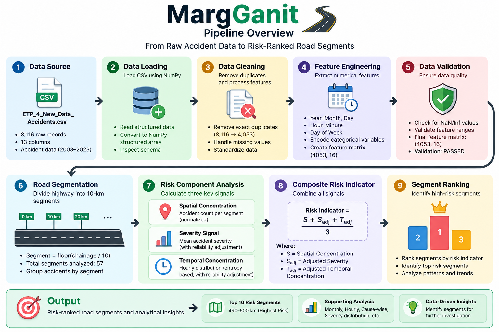
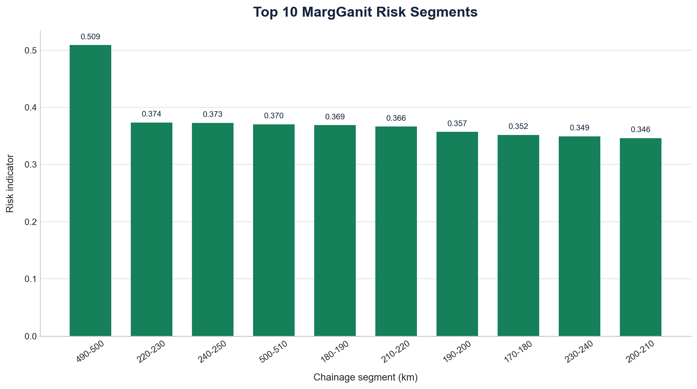
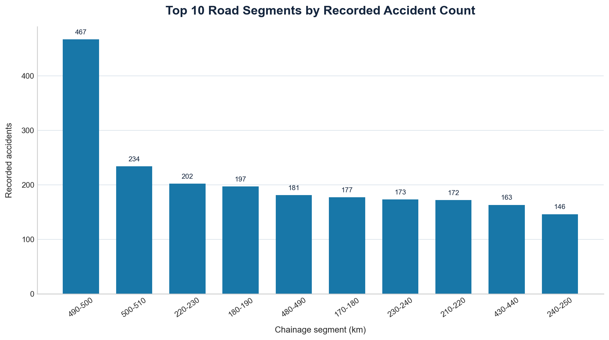

# MargGanit

### NumPy-powered road safety analytics

MargGanit is a reproducible road-safety analytics engine built with Python and NumPy. It processes historical accident records, divides the road into 10-km segments, and ranks those segments using a relative composite risk indicator.

The analysis combines:

- Spatial accident concentration
- Mean accident severity
- Temporal concentration based on hourly entropy
- A small-sample reliability adjustment

> MargGanit is an analytical indicator for prioritizing further investigation. It is not an official road-safety rating or an exposure-adjusted crash rate.

## Dataset

The project uses `ETP_4_New_Data_Accidents.csv`, containing 8,116 raw records across 13 columns. Exact duplicate removal leaves 4,053 unique records for analysis. The records cover 2003–2023, with gaps between some recorded years.

Dataset source: [Zenodo record 16946653](https://zenodo.org/records/16946653)

## How It Works

The pipeline loads and deduplicates the source data, extracts numerical time and location features, validates the resulting feature matrix, and calculates segment-level risk signals before ranking the occupied road segments.



### Risk indicator

For each occupied 10-km segment, the baseline indicator gives equal weight to three normalized components:

```text
Risk Indicator =
    (Spatial Concentration
     + Adjusted Severity
     + Adjusted Temporal Concentration)
    / 3
```

The severity and temporal components are regularized with a reliability factor based on the segment's record count. This reduces the influence of unstable estimates from very small samples. Equal weighting is an analytical assumption, not a learned model parameter.

## Key Results

The current analysis identifies the `490–500 km` segment as the highest-ranked segment, with a risk indicator of `0.509` and 467 recorded accidents.



### Top-ranked segments

| Rank | Segment | Risk Indicator | Recorded Accidents | Mean Severity |
| ---: | :--- | ---: | ---: | ---: |
| 1 | 490–500 km | 0.509 | 467 | 2.411 |
| 2 | 220–230 km | 0.374 | 202 | 2.728 |
| 3 | 240–250 km | 0.373 | 146 | 2.966 |
| 4 | 500–510 km | 0.370 | 234 | 2.568 |
| 5 | 180–190 km | 0.369 | 197 | 2.701 |
| 6 | 210–220 km | 0.366 | 172 | 2.814 |
| 7 | 190–200 km | 0.357 | 121 | 2.934 |
| 8 | 170–180 km | 0.352 | 177 | 2.689 |
| 9 | 230–240 km | 0.349 | 173 | 2.711 |
| 10 | 200–210 km | 0.346 | 122 | 2.918 |

The ranking demonstrates why accident count alone is insufficient: a segment with fewer recorded accidents can still receive a strong composite score when severity and temporal concentration contribute to its result.

## Analysis

The concentration view shows where recorded accidents are most numerous. It is a complementary view to the composite ranking and should not be interpreted as a risk rating by itself.



The notebooks also examine:

- Dataset schema and duplicate records
- Date, month, hour, and day-of-week distributions
- Segment-level accident counts and severity
- Hourly entropy and temporal concentration
- Cause-code distributions
- Day-versus-night severity distributions
- Feature-matrix validation

## Validation

The generated numerical feature matrix is validated for shape, missing values, infinite values, and expected feature ranges.

```text
Feature matrix: (4053, 16)
NaN values: 0
Infinite values: 0
Validation: PASSED
```

## Project Structure

```text
MargGanit/
├── assets/
│   ├── accident_concentration.png
│   ├── margganit_pipeline.png
│   └── risk_ranking.png
├── data/
│   └── ETP_4_New_Data_Accidents.csv
├── notebook/
│   ├── 01_data_exploration.ipynb
│   ├── 02_numpy_cleaning.ipynb
│   ├── 03_risk_engine.ipynb
│   └── 04_analysis.ipynb
├── src/
│   ├── __init__.py
│   ├── data_loader.py
│   ├── preprocessing.py
│   ├── risk_engine.py
│   ├── main.py
│   └── test.py
└── README.md
```

## Technology

- Python
- NumPy
- Matplotlib
- Jupyter Notebook
- Git / GitHub

## Running the Project

From the `MargGanit` project root:

```powershell
python -m venv .venv
.venv\Scripts\Activate.ps1
pip install numpy matplotlib jupyter
python -m src.main
python -m src.test
```

## Limitations

- Accident counts are not adjusted for traffic volume or vehicle-kilometre exposure.
- The source data contains gaps between recorded years.
- Numeric cause, weather, road-condition, and vehicle codes are not semantically interpreted without a codebook.
- Small samples can produce unstable segment statistics; reliability adjustment reduces but does not eliminate that instability.
- The equal component weighting is an analytical assumption.
- The indicator describes the provided dataset and does not establish causal relationships.

## Reproducibility

The notebooks document the exploratory and analytical workflow. The `src/` package contains the reusable implementation that reproduces the core cleaning, validation, risk calculation, and ranking steps.

## Project Status

**Core NumPy implementation complete.**

The project includes exploratory analysis, data cleaning, feature engineering, validation, segment-level risk modeling, visualization, and a reusable Python implementation.
